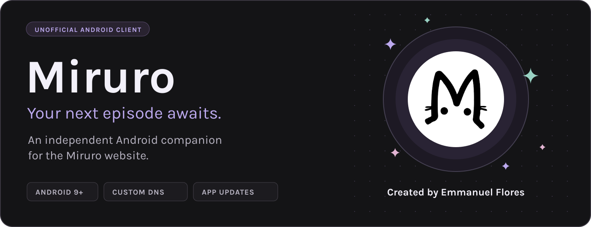
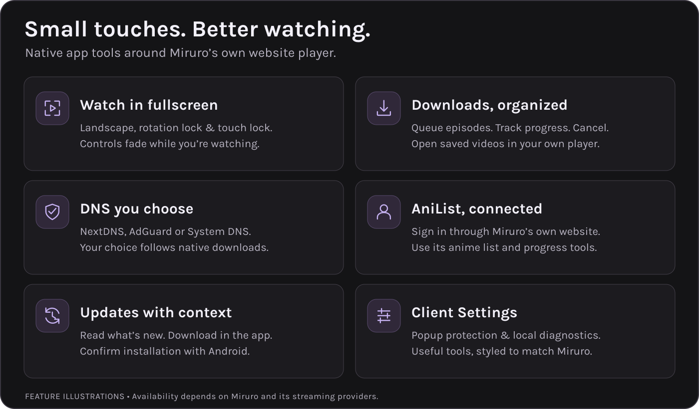

  <picture>
    <source media="(max-width: 640px)" srcset="docs/assets/miruro-banner-mobile.png">
    
  </picture>

  

  <a href="#features">Features</a> ·
  <a href="#get-started">Get started</a> ·
  <a href="#player-controls">Player controls</a> ·
  <a href="#downloads">Downloads</a> ·
  <a href="https://github.com/emmandesu/Miruro/releases">Release notes</a>

**Miruro is an independent Android app that brings the Miruro website into a dedicated app interface.** It keeps the website’s own player and AniList integration, with native controls for fullscreen, downloads, connection settings and app updates.

**Android 9+** · **Targets Android 16 / API 36** · **Android System WebView required** · **Created by Emmanuel Flores**

## Features

  <picture>
    <source media="(max-width: 640px)" srcset="docs/assets/miruro-features-mobile.png">
    
  </picture>

A few more things that make everyday watching easier:

- **Picture in picture.** Keep the current streaming video in a small Android window, with Play/Pause and a return to the existing player. Automatic entry while leaving during playback can be turned off.
- **Playback-aware screen timeout.** The screen stays awake while a trusted video plays, including inline playback. Pausing, ending or backgrounding allows normal sleep.
- **Community sign-in.** The comments panel can open The Anime Community’s login and registration windows. Community accounts are separate from AniList.
- **Miruro links and backup domains.** Choose supported links in Android settings and manage Miruro addresses from Client Settings.
- **Connection feedback.** A small banner tells you when the connection is lost or restored.
- **Notifications in two places.** Mirror the website’s Miruro/AniList notices to Android, and see available app updates inside the site’s notification panel.
- **A welcome that knows when to leave.** The animated Miruro loading screen is for initial startup, with anime quotes and a first-use menu guide.
- **Detailed diagnostics.** Live player/PiP state, buffering and pause-command correlation, lifecycle/renderer errors, resource failures, issue markers and JSON export. Recording is opt-in and local, with no automatic uploads.

> Notification delivery follows the website receiving or rendering its notices. It is not server push while Android has closed the app. Update checks run daily when opened, or manually.

## Get started

1. Open the **[latest release](https://github.com/emmandesu/Miruro/releases/latest)** and download its signed `.apk`.
2. Install it on Android 9 or newer with Android System WebView installed and enabled.
3. Open Miruro and choose your DNS provider in **Client Settings → Connection**.
4. Sign in to AniList through the website if you want to use its list and progress tools. For comments, use **Log In** or **Sign Up** inside the community panel.

**Already using Miruro? Install over the existing app.** Keep it installed to retain your app settings and sign-in. Builds before 1.0.15 need a one-time manual update to connect to this repository’s updater.

For later updates, open **Client Settings → Support → App updates**. You can read the release notes, download inside the app, and confirm installation with Android. The updater checks the package, version, checksum and installed signing identity before installation. Its downloaded APK is cleaned up after successful installation, with another cleanup check on reopening.

## Player controls

| Control | What it does |
| --- | --- |
| **Fullscreen** | Opens the video in landscape and hides the status and navigation bars. |
| **Orientation lock** | In fullscreen, tap the rotating-phone control above touch lock to allow rotation. Rotate the device, then lock again to hold the current angle. Exiting fullscreen restores the prior app rotation setting. |
| **Touch lock** | Blocks accidental taps and swipes over the player. Tap the video to reveal Unlock; Back also unlocks. Unlock touches before changing orientation. |
| **Picture in picture** | Tap the player’s left-side native PiP button, or leave the app while a supported video is playing. Android supplies Play/Pause, expand and close. |
| **Player Download icon** | Captures the current supported stream, checks its format, then asks where to save the full episode. |

The lock buttons fade with the player controls. Miruro continues to use the website’s player; it does not replace playback with a separate native anime player.

**PiP settings:** open **Client Settings → General → Player → Picture in picture** for manual entry, automatic-entry preference and the Android permission shortcut. The current `strm.cx` player and direct Miruro media-player/control-enabled video are supported. Paused or ended videos do not open automatically. Closing the small window pauses playback; expanding returns to the same player. Android displays a playback notification while PiP is active. A supported device, PiP permission and a current WebView are required.

## Downloads

Open **Downloads** in Miruro’s main menu for active progress, queued episodes and completed files. Add up to **20 pending episodes**; one downloads at a time. Tap **×** to cancel an item, or tap a completed file for Android’s **Open with** chooser.

| Download route | What to expect |
| --- | --- |
| **Player icon → current stream** | Supports the observed `pinewren.top` CDN used by the sun player. Complete plain HLS with embedded audio saves as `.ts`; supported MP4 sources save as `.mp4`. No external download page is opened. |
| **Episode menu → Download** | Opens the supported provider page in a restricted window. Choose **Prepare download → Download MP4**, then select a save location. |

**Use a compatible player such as VLC for `.ts` files.** Separate player captions are not included. HLS size and progress are estimates. Encrypted, live and unsupported stream layouts show a message; use the provider route where available.

Playlists and files use the DNS provider selected when the job starts. Stream links can expire while queued. If Android interrupts a transfer, prepare a fresh link; partial downloads do not resume. Finished history holds up to 100 entries, and clearing that history keeps your saved videos.

## Connection and protection

Choose **NextDNS** using the `ac7389` profile, **AdGuard DNS**, or **System DNS** in **Client Settings → Connection**. The selection applies to supported app connections, native downloads and update checks. Encrypted DNS does not silently fall back to System DNS.

Popup and redirect protection reduces unwanted external windows. It does not guarantee that every advertisement is removed. Video availability, streaming quality and provider behavior remain controlled by Miruro and its sources.

## Help, credits and project details

- **Menu access:** open Miruro’s website menu, then select **Client Settings**. A two-finger tap outside fullscreen reveals the backup menu button.
- **Report an issue:** enable **Client Settings → Support → Diagnostics**, reproduce the problem, and export the log. Review it before attaching it to an [issue](https://github.com/emmandesu/Miruro/issues).
- **Licenses and credits:** **Client Settings → Support → Licenses & credits** includes the bundled AndroidX libraries, Chromium boundary interfaces and Karla font, with offline license texts and acknowledgements.
- **Release history:** read [what changed](docs/release-history.md) or browse [GitHub Releases](https://github.com/emmandesu/Miruro/releases).
- **For the maintainer:** [publishing signed releases](docs/publishing.md).

This repository distributes pre-signed APK releases and update metadata. Application source archives are not published here.

<strong>Verification and known testing limits</strong>

The 1.0.27 release compiles against and targets **API 36 (Android 16)**, with minimum API 28 (Android 9). It passes automated regression checks and retains the original owner signing identity. The compiled APK’s SDK levels, version and signing certificate are verified; release preparation rejects mismatched SDK levels. Coverage includes navigation and popup policy, player state, download validation and queue behavior, notification deduplication, update verification and the stream-download bridge.

The community service could not be accessed from the build environment, so live account login, registration and commenting still need a phone check. Actual PiP transitions, OEM permissions, Play/Pause delivery, audio interruptions, Android 16 edge-to-edge layout, Back gestures, keyboard behavior, tablet/foldable orientation locking, Android permission prompts, the save picker, video-player chooser, live custom-DNS transfers, background delivery and installation still require physical-device validation. This is not a claim that every provider or device has been tested.

---

   
  <strong>Created by Emmanuel Flores · © 2026</strong> 
  An independent companion. Not affiliated with, authorized by, or endorsed by Miruro or AniList. 
  The app does not host or provide anime content. Miruro branding belongs to its respective owners.

PiP repair in 1.0.26 removes the duplicate audio-focus controller and moves manual entry to the native player overlay. Sustained playback on the reported device still needs confirmation.

## Capturing an issue

Open **Client Settings → Support → Diagnostic logs**, enable recording, then reproduce the problem. Use **Capture state / mark issue** if helpful and choose **Export diagnostic report** to save the JSON file. Live events can be paused for reading.

Version 1.0.27 adds a timed event timeline and player state snapshots, PiP decision flags and commands, categorized script/resource errors, renderer stalls and Android process-exit context where available. Reports exclude credentials, full URLs, page/response text and raw console messages. Recording cannot recover earlier events; a pause with no recent app command does not prove its cause. Logs rotate within 1 MB. **1,210 automated checks pass**; physical-device event delivery still needs verification.
