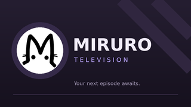

# Miruro TV · setup and remote guide

Created by Emmanuel Flores. An unofficial Android TV / Google TV client for
https://miruro.cx/, based on the maintained Miruro 1.0.31 client. This is a
separate TV application, with its own data and update channel.

- Application: **Miruro TV**
- Package: `com.emflo.miruro.tv`
- Version: `1.0.0_tv` · versionCode **1**
- Minimum: **Android TV / Google TV with Android 9 / API 28**
- Compile / target: **Android 16 / API 36**
- Android System WebView must be installed, enabled and current. No browser
  engine is bundled. Old engines without the required document-start and web
  message features show an upgrade prompt.

## Made for a remote

A native navigation rail offers Home, Discover, Search, History, Downloads,
Client Settings and Remote guide. Controls have a strong lavender focus state,
large tap/focus targets and scrolling support. The TV launcher has a dedicated
320×180 banner, 320×320 icon, Leanback launcher entry and landscape layout.
Touchscreens are explicitly optional. The app keeps sensible TV safe margins
and removes them during fullscreen playback.

| Remote button | Browsing | On the player |
| --- | --- | --- |
| Arrows | Move visible focus between items | Left/right seeks 10 seconds |
| OK / Select | Activate focused item or edit a field | Play/pause |
| Up | Move to the item above | Open playback controls |
| Back | Close a site menu, return through history, then Home/exit | Close controls, exit fullscreen, return to browsing |
| Menu, when present | Reach navigation / playback tools | Open playback controls |
| Home / volume / microphone | Handled by Android | Handled by Android |

The player control bar includes rewind, play/pause, forward, captions, player
settings, fullscreen and download. It fades during playback; paused controls
remain available. Search and login use the television's own keyboard. Bluetooth
and USB keyboards can also type normally. Xiaomi's standard Android TV D-pad
remote uses the same supported key codes; optional media and gamepad A keys are
handled too.

The website's original cards, menus and player remain in place. A bounded
spatial-navigation observer follows interactive elements and open shadow roots,
keeps modal focus inside the active dialog, and scrolls nested episode lists.
Focus is rebuilt after page changes and restored through browser Back/forward
cache transitions. Native user-key activation preserves the normal keyboard
path for controls that depend on a user gesture; the app does not enable all
popup windows.

Fullscreen expands the existing player with scoped layout styles and native
TV chrome; it does not create another stream, player, activity or decoder.
Existing provider fullscreen callbacks are supported as well.

## Existing Miruro features

Selected NextDNS (ac7389), AdGuard or System DNS also applies to supported native
transfers. Popup filtering, AniList/community sign-in windows, downloads with
queue/progress/cancel/Open with, notifications, licenses and opt-in diagnostics
are retained. Touch lock, rotation lock and the phone brightness overlay are
not shown in the TV player. Normal screen-awake behavior follows playback.
Automatic PiP is off by default in this TV edition. Leaving the TV app pauses
the current video.

Downloads need a compatible TV document picker/storage provider; some televisions
need an additional file manager. Opening completed files requires an installed
TV video player. Streaming formats, quality and availability still depend on
Miruro and its providers. No content is hosted by this client.

## Install and update

Sideload **Miruro-1.0.0_tv.apk** on the TV. Allow installation for the app you use
to open that file if Android asks. It appears in the TV launcher as Miruro TV.
The phone app can remain installed; the two packages do not replace each other
or share sign-in, download history or preferences.

Later releases use **Client Settings → Support → App updates**. The fixed feed
is `https://raw.githubusercontent.com/emmandesu/Miruro/main/tv/update.json`.
Only TV-tagged APK URLs, the exact TV package, newer version codes, matching
checksums and the installed signing identity are accepted. Android still asks
for installation approval. TV releases do not advance the phone update feed
or replace the repository's latest phone release.

## Verification limits

The signed API 36 APK is compiled and its package, version, signature, launcher,
landscape and no-touch requirements are checked. TV-specific checks cover remote
key/origin/command policy, actual native-controller bytecode with Android input
and scheduling doubles, and the actual DOM observer with jsdom. The inherited
client regressions also pass.

These automated checks are not an Android TV hardware certification. A physical
Xiaomi TV/TV Box, remote reconnection, vendor WebView, IME, live OAuth/provider
login, captions, hardware decoding, file picker and sideload-update flow still
need real-TV confirmation. No claim is made that every TV or streaming provider
was tested.

This is an independent companion, not affiliated with Miruro or AniList.
Branding belongs to its owners. See THIRD-PARTY-NOTICES.md and in-app credits.
